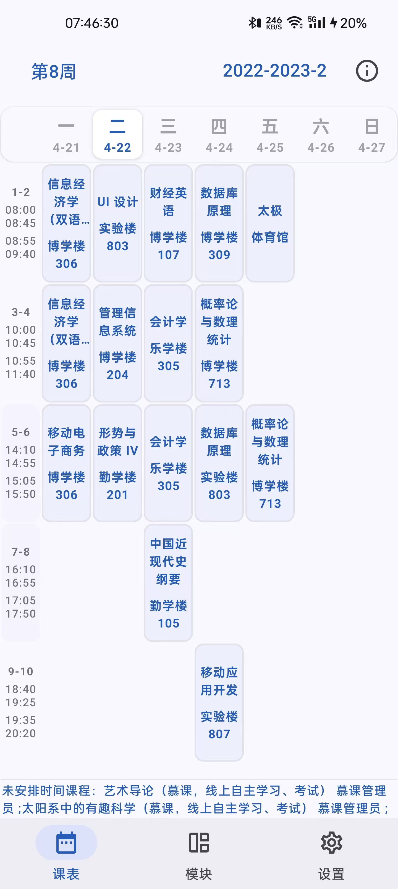
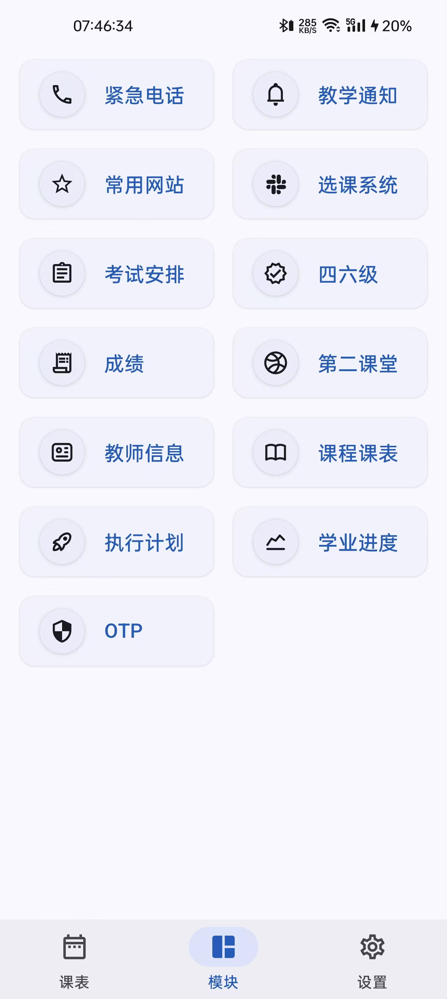
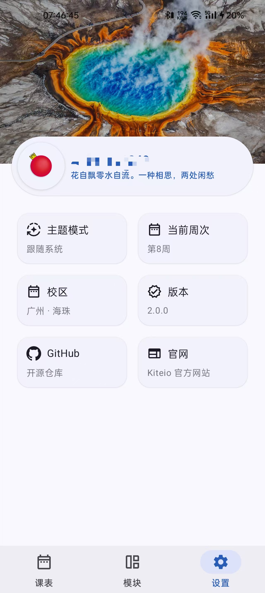

# 小石榴

    

> [!IMPORTANT]
> **新版小石榴请前往 [Pomegranate](https://github.com/chanwingchow/Pomegranate)。**
> 新版目前处于测试阶段，可以与本仓库的旧版并存；重要操作建议暂在旧版完成。

<table>
  <tr>
    <td width="50%" align="center">
      <strong><a href="https://github.com/chanwingchow/Pomegranate">查看新版仓库 →</a></strong> 
      Pomegranate · 源码、截图与使用说明
    </td>
    <td width="50%" align="center">
      <strong><a href="https://github.com/chanwingchow/Pomegranate/releases/latest">下载新版 →</a></strong> 
      查看各平台安装包与发布说明
    </td>
  </tr>
</table>

## 简介

小石榴是由广东财经大学 21 级学生开发的教务系统客户端，软件 UI 基于 Material Design，提供更人性化的服务。

小石榴目前支持 Android（安卓） 和 Windows，使用 Compose Multiplatform 开发。如果有大佬有苹果电脑，欢迎参与 Mac OS 和 iOS 的维护和发行。

教务系统一天不改，小石榴一天不倒。

## 注意

小石榴教学数据来源广财官方网站，使用 HTML 解析，因官方 HTML 书写不规范，可能会出现解析错误。

## 截图

    
    
    

## 支持

小石榴是一款公益项目，软件完全免费且无广告。好的软件需要有更多人发现，如果您喜欢石榴，请点亮仓库星标。
此外，您也可以向好友分享它。
